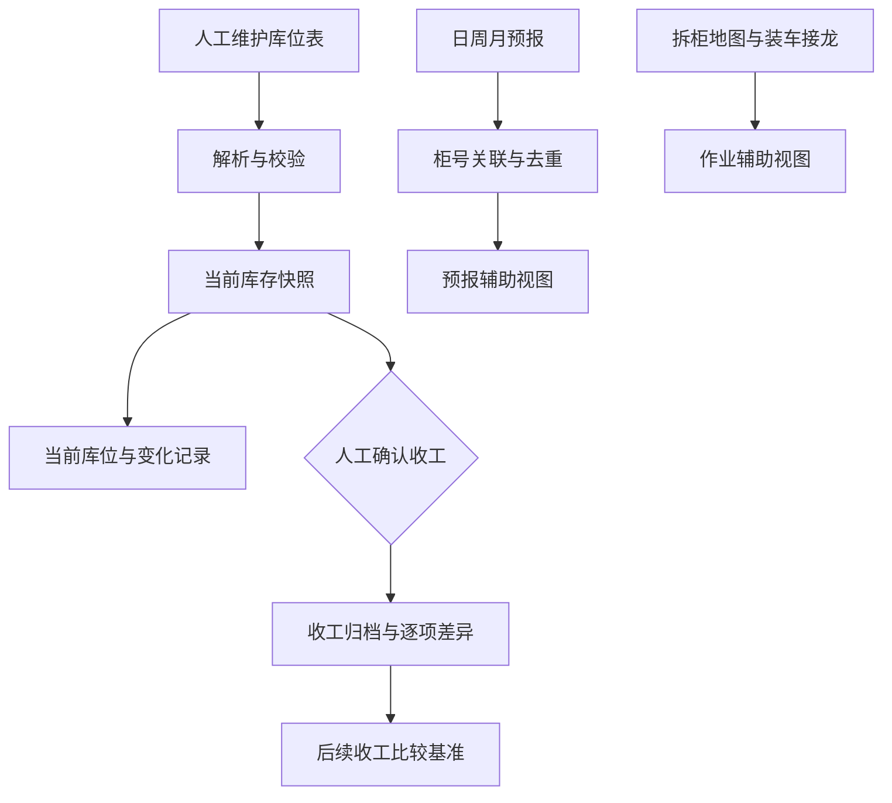

[README.md](https://github.com/user-attachments/files/34506296/README.md)[Uploading RE# WINGTAT NJ 库位项目

基于 **Google Sheets + Google Apps Script** 的仓库库位与库存记录管理项目，服务于拆柜入位、装车出库、移库、晚间盘点和到货预报等日常作业。

项目从 NJ 仓库的实际操作需求出发：保留现场人员熟悉的表格，把分散的数据读取、变化记录、预报去重和收工对账串联起来，让每个环节都有明确的数据来源和查看入口。

**当前版本：v1.7.0 · 表格读取模式。** 库位、仓点、货物标识和实际板数由人员在原库位表中维护，系统直接读取并比较，不再依赖 AI 识图或推断货量。

> 当前实现是面向既有仓库表格及 WTC 系统的定制升级工程。迁移到其他仓库时，需要适配数据源、表格布局和业务规则，尚未提供全新项目的一键安装向导。

## 核心功能

| 功能 | 当前实现 |
| --- | --- |
| 库位读取 | 解析库位、仓点或货物标识、明确板数及来源单元格，汇总当前表格记录 |
| 变化追踪 | 按物理库位与货物标识比较，记录数量、标识和来源位置的变化 |
| 收工盘点 | 人工确认后保存快照，逐项比较两次收工记录，保留追查依据 |
| 预报去重 | 关联日、周、月预报，同柜优先采用日预报，其次周、月预报，不直接累加 |
| 新柜接入 | 从已配置来源及近期符合格式的预报页、拆柜日期页读取新柜 |
| 作业对照 | 展示拆柜地图与装车接龙中的状态，辅助核对现场作业 |
| 问题定位 | 对缺失数量、冲突、日期异常和来源读取失败显示对象及原表单元格 |
| 异常保留 | 读取失败时保留上次有效数据，明确标记时效，不把失败当成空仓 |

## 数据如何流转



库位表是当前实存的唯一依据。预报表示计划到货，拆柜及装车状态表示作业进度；这些辅助信息不会再次增加或扣减库存。

## 日常使用

| 场景 | 人员操作 | 系统结果 |
| --- | --- | --- |
| 拆柜入位 | 货物入位后，在库位表填写对应货物及实际板数 | 读取新的库位记录 |
| 装车出库 | 取货后，将对应货物改为剩余实际板数 | 更新剩余数量；接龙换行、改日期或补信息不会重复扣减 |
| 实际移库 | 更新原库位和目标库位的货物、板数 | 保存两处表格变化，供后续核查 |
| 晚间盘点 | 核对库位表，立即读取并检查问题，再确认保存收工快照 | 归档当天结果，生成与上次收工的差异 |
| 次日作业 | 继续维护同一张库位表 | 延续读取及比较，无需重复建立初始库存 |
| 更新预报 | 维护原始预报页和必要的柜号对应关系 | 更新去重预报及新柜辅助信息 |

Google Sheets 中的操作入口：**库位同步 → 打开库位工作台**。

库存来源约每 **1 分钟**检查一次，预报和作业辅助来源约每 **5 分钟**检查一次。安装账号可手动发起读取。执行时间可能延迟，不属于即时推送；共享编辑者的原表改动也会在后续读取中反映。

## 数据规则

- **空白不等于零。** 某条货物取完时，保留其标识并填写 `0P`；只有整个库位确实无货时，才标记为空位。
- **明确数量与未知数量分开。** 存在缺失或冲突时，仅展示“表内明确板数小计”，不宣称全仓库存完整。
- **容量不等于库存。** 标准容量用于参考，不替代实际板数，也不代表精确可用余位。
- **表格变化不等于已核实的作业流水。** 数量增减、一增一减或记录消失，不自动证明入库、出库或移库原因。
- **原表与结果分离。** 系统读取业务原表，在独立结果页保存状态和记录；首读建立新比较基准，不把旧账混入。
- **重复操作不重复登记。** 无实质变化的读取不新增库存变化记录；同日期、同来源版本的收工保存不重复登记。
- **旧入口隔离。** 启用表格模式后，旧照片、回单、装车、移库和盘点入账入口停止受理，历史记录保留。

## 结果页

| 页签 | 用途 |
| --- | --- |
| `WTC当前库位` | 当前读取到的货物、明确板数、未知项及来源格 |
| `WTC表格变化` | 两次读取之间的记录差异 |
| `WTC读取问题` | 需要回到来源表核对的问题 |
| `WTC收工快照` | 经人工确认保存的收工记录 |
| `WTC收工差异` | 两次收工之间的逐库位、逐货物差异 |
| `WTC表格预报` | 柜号关联、预报去重及来源时效 |
| `WTC表格作业` | 拆柜、装车辅助状态 |

## 技术与部署

使用 Google Sheets 维护业务数据，Google Apps Script 执行读取、校验、后台任务及工作台交互；核心解析与比较逻辑使用 JavaScript，测试使用 Node.js，内部发布包由 Python 脚本生成。

主要模块位于 `nj_load_sync/`：

| 文件 | 职责 |
| --- | --- |
| `table_inventory_core.js` | 库位解析、数量校验与快照比较 |
| `table_source_reader.gs` | 预报、拆柜地图、装车接龙的只读采集 |
| `table_inventory_adapter.gs` | 独立状态保存、定时读取与收工归档 |
| `table_inventory_ui.gs` | Google Sheets 库位工作台 |
| `*.test.js` | 核心逻辑及 Apps Script 模拟测试 |

其余引擎与适配器保留旧版兼容及迁移保护逻辑。

部署前需要核对并适配：

1. 主数据表、外部拆柜地图、库位页及相关页签的绑定配置。
2. 库位矩阵、表头、数量表达方式、预报格式和接龙列映射。
3. 业务时区、禁用库位、容量规则及辅助来源的读取范围。当前实现采用美东业务时区。
4. 安装账号对来源表的读取、结果表的写入、Google Sheets API 和项目触发器的相应权限。

对于已安装旧版的 WTC 环境，升级顺序为：暂停旧同步并等待在途执行结束 → 备份旧代码 → 替换完整脚本 → 运行 `WTCLoad_upgradeProjectV17` → 核对读取结果 → 运行 `WTCLoad_resumeAfterMaintenance` → 使用 `WTCLoad_syncTableInventory` 验证。

这些函数依赖已有安装身份与后台状态，不适用于未经适配的空白项目。新库存流程不需要 OpenAI API Key；ChatGPT 定时汇总属于独立配置，并非安装脚本后自动提供。

## 验证与适用范围

v1.7.0 内部发布版本通过 **724 项检查**，并完成线上手动读取与定时读取验证。检查覆盖空白与零的区分、数量冲突、行位置变化、重复提交、来源失败保留、跨年份日期、旧入口隔离及收工比较。

内部测试命令：

```bash
cd nj_load_sync
node --test *.test.js
```

部分内部测试依赖业务样本；公开代码前应替换为合成样本并重新验证。上述检查数量不代表尚未整理的公开仓库可直接通过全部测试。

本项目提供表格数据读取与核对支持，不替代完整 WMS，也不独立证明现场账实一致。当前版本不包含自动生成并发布拆柜单标注文件、私仓自动分配、office 归线处理或真实操作人身份审计。

## 公开发布说明

公开仓库仅应包含已脱敏代码、文档和合成示例。请使用示例配置替代生产绑定，排除凭据、真实业务样本、照片回单、库存快照、升级备份及线上日志。

现有内部发布包包含生产备份和业务样本，不适合直接作为公开 Release 附件。发布源码时，应单独整理公开版文件清单，并确认代码及相关资料的授权范围。
ADME.md…]()
